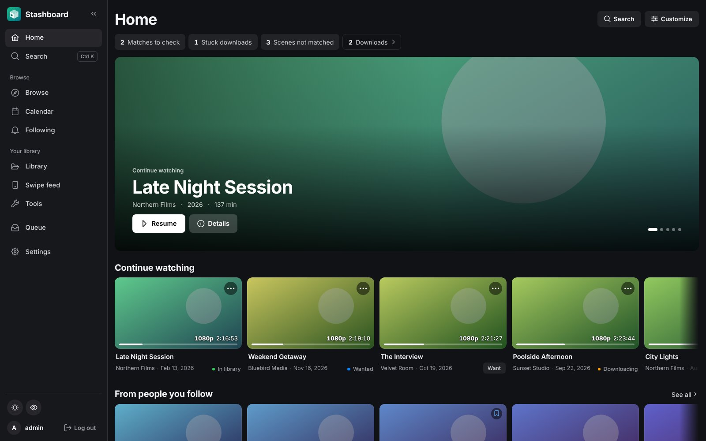
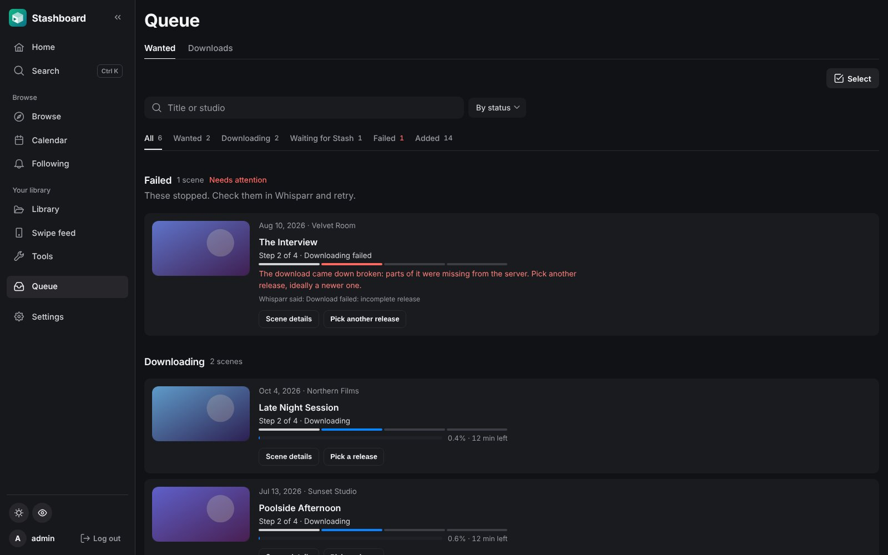
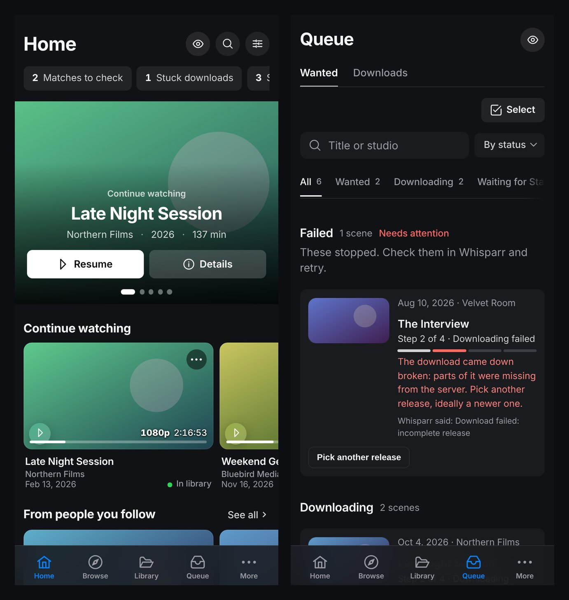

# Stashboard

Stashboard is a self-hosted app that finds scenes on a supported catalog provider, gets the ones you want through Whisparr, and checks them against your local Stash library.

[](https://github.com/mrnogood356/stashboard/releases/latest)
[](https://github.com/mrnogood356/stashboard/actions/workflows/ci.yml)
[](LICENSE)
[](#self-hosted-quick-start)
[](#self-hosted-quick-start)
[](#self-hosted-quick-start)

## What Stashboard Does

Stashboard sits between your catalog (StashDB or FansDB), Whisparr and Stash. Find a scene, mark it Wanted, follow it through the download into Stash, then watch it in the same app on your phone or desktop.

### Find scenes

- Browse your catalog provider by scenes, performers and studios, with filters for tags, studios and more. FansDB can sit next to StashDB as an extra browse provider (Settings → Integrations); Wanted scenes keep going through your main one.
- Search finds scenes, performers and studios in the catalog and in your library at once.
- Calendar shows what's coming out, and You may enjoy suggests scenes by the categories you pick.
- Follow performers and studios (optionally only scenes with chosen tags) and get their new scenes on Home and in notifications, or have them marked Wanted for you.

### Wanted and downloads

- Mark a scene Wanted and Stashboard hands it to Whisparr, then shows each step: searching, downloading, importing, in Stash.
- Pick a release yourself: see every release your indexers found (quality, size, seeders, age, why Whisparr would skip it) and download the one you want.
- Get Discord, ntfy or webhook notifications when a scene starts downloading, lands in your library, or fails (Settings → Notifications).
- New scenes on autopilot (Settings → Automation): when Whisparr imports a scene, Stash scans it, identifies it on StashDB and generates its previews. Add Stashboard's webhook in Whisparr to make it instant; otherwise Stashboard notices new imports by itself within about 15 minutes.

### Watch your library

- A built-in player with resume, scrub previews, quality choice, picture-in-picture, AirPlay/Chromecast, looping a part or a chapter, and mirroring. Progress and play counts sync back to Stash. Files your browser can't play are converted by Stash on the fly, so enable Stash's live transcoding.
- Continue watching, Watch later with a play queue, History, chapter playlists, and a swipe feed for phones.
- Library cards show quality and length on the picture, and you can sort by Stash's production date.

### Tools for your library

- **Match scenes**: matches scenes Stash couldn't identify using every source it can reach: your main catalog, every other stash-box set up in Stash (FansDB, ThePornDB…), ThePornDB from its API key, and Stash's own scrapers. It tries video fingerprints first, then the file name, and shows likely matches with covers and reasons. "Match all" saves only the sure matches and can run every night. Matched scenes that Whisparr shows as missing are handed to Whisparr's Manual Import, so Whisparr counts them as downloaded.
- **Rename files**: names and folders follow Whisparr's own naming, so both apps agree. It shows a preview first, can run after each match, never touches files Whisparr manages, and the last run can be undone. It also removes folders left empty, and Repair Whisparr points scenes Whisparr shows as missing back at the right root folder.
- **Better copies**: swaps files that are too big, or too low quality, for a better copy, a few scenes an hour. The new file is checked before the old one is ever replaced.
- **Broken files**, **Duplicates**, **Merge** (performers or studios entered more than once), **Tag cleanup**, **Samples**, **Library stats**, **Stash jobs** and **Schedules**. **Activity** lists everything Stashboard did, with Undo for renames.
- Tools that change files need to see your media: mount the same media path into the Stashboard container as Stash uses (for example host `/mnt/user/data` → container `/data`). If Stash and Whisparr see your media under different paths, set the folder mapping in Settings → Integrations and tap "Save and check".

### Make it yours

- Light and dark themes, an accent colour that can follow the artwork, and a Home page you can rearrange.
- App Lock (Settings → Privacy): require a PIN to reopen Stashboard after it's been in the background, enforced by the server. Face ID works too when Stashboard is opened over HTTPS with a domain name. Stashboard also tries to cover the screen when you leave, but iOS can still show a preview in the app switcher.
- Install it on your phone: in Safari use Share → Add to Home Screen; in Chrome use Install app.

## Screenshots





<p align="center">
  
</p>

Screenshots use sample data.

## What You Need

- Docker and Docker Compose on the machine that will run Stashboard
- An existing Stash instance that Stashboard can reach
- An existing Whisparr instance that Stashboard can reach
- A supported catalog provider to configure during setup: StashDB or FansDB

## Self-Hosted Quick Start

Normal self-hosted installs do not require a repo checkout or a separate `.env` file. Create an empty folder, save the following as `compose.yaml`, change the database password once before first start, and optionally change the host port or pin the image tag. This snippet matches [`infrastructure/compose/compose.example.yaml`](infrastructure/compose/compose.example.yaml).

```yaml
x-db-env: &db-env
  POSTGRES_DB: stashboard
  POSTGRES_USER: stashboard
  # Change this once before your first start.
  POSTGRES_PASSWORD: change-this-password

services:
  postgres:
    image: postgres:17-alpine
    environment:
      <<: *db-env
    volumes:
      - stashboard_postgres_data:/var/lib/postgresql/data
    healthcheck:
      test: ['CMD-SHELL', 'pg_isready -U $$POSTGRES_USER -d $$POSTGRES_DB']
      interval: 5s
      timeout: 5s
      retries: 10
      start_period: 10s
    restart: unless-stopped

  app:
    # Change latest to an exact release like v0.1.0 if you want to pin upgrades.
    image: ghcr.io/mrnogood356/stashboard:latest
    depends_on:
      postgres:
        condition: service_healthy
    volumes:
      - stashboard_app_data:/var/lib/stashboard
    environment:
      <<: *db-env
      DATABASE_HOST: postgres
      DATABASE_URL: ""
      HOST: 0.0.0.0
      PORT: 3000
      DATABASE_MIGRATION_MAX_ATTEMPTS: 30
      DATABASE_MIGRATION_RETRY_DELAY_SECONDS: 2
      # Optional advanced override. Leave unset to let Stashboard generate and persist
      # a unique session secret for this install in the app data volume.
      # SESSION_SECRET: your-own-long-random-secret
      # Optional: uncomment if catalog provider checks time out on IPv4-only Docker networks.
      # NODE_OPTIONS: --no-network-family-autoselection
      # Optional: a code the first visitor must enter to create the admin account.
      # Set it if the page can be reached before you've signed up.
      # SETUP_CODE: pick-a-long-code
      # The user Stashboard runs as. It can only rename and clean up media this user
      # may change, so match your media's owner (Unraid: 99/100; most Linux: 1000/1000).
      PUID: 99
      PGID: 100
    ports:
      # Change the left side if port 3000 is already in use on the host.
      - "3000:3000"
    restart: unless-stopped

volumes:
  stashboard_postgres_data:
    name: stashboard_postgres_data
  stashboard_app_data:
    name: stashboard_app_data
```

Both services reuse the same `POSTGRES_*` values from `x-db-env`, so you change the database password in one place only. On first boot, Stashboard automatically generates a unique session secret for that install and persists it in the app data volume. You only need to set `SESSION_SECRET` yourself if you want an advanced manual override.

Then start Stashboard with:

```bash
docker compose up -d
```

Open `http://localhost:3000`.

On the first visit, Stashboard opens a bootstrap screen until you create the single local admin account. After that, unauthenticated visits land on the login screen and normal app and API usage require that session.

If StashDB or FansDB Save & Test repeatedly fails with `ETIMEDOUT` on an IPv4-only Docker network, add
`NODE_OPTIONS: --no-network-family-autoselection` to the app service environment and restart the container.

Tag guidance:

- `latest` is the newest stable release and the recommended default.
- `vX.Y.Z` pins an exact release.
- `edge` follows unreleased builds from `main` and is meant for early adopters.

## Optional Settings

| Variable | Default | What it does |
| --- | --- | --- |
| `TRUST_PROXY` | unset | Set when Stashboard sits behind a reverse proxy: `1` for one proxy in front, or the proxy's address or network (such as `172.18.0.0/16`). Login throttling then sees each visitor's real address, and HTTPS through the proxy marks the sign-in cookie Secure. Let only the proxy reach the app's port. `true` trusts any address and isn't recommended. |
| `SESSION_COOKIE_SECURE` | auto | The sign-in cookie is marked Secure whenever you visit over HTTPS. Set `true` or `false` to force it. |
| `SETUP_CODE` | unset | A code the first visitor must enter to create the admin account. Set it if the page can be reached before you've signed up. |
| `DATABASE_PORT` | `5432` | Postgres port used when `DATABASE_URL` is derived from the `POSTGRES_*` values. |
| `MEDIA_CACHE_TTL_HOURS` | `24` | How long Stash screenshots and logos are kept in the image cache. |
| `MEDIA_CACHE_MAX_MB` | `512` | Size cap for the image cache; the oldest images are removed first. |
| `MEDIA_CACHE_DISABLED` | unset | Set to `true` to turn the image cache off. |
| `PUID` / `PGID` | `99` / `100` | The user and group Stashboard runs as (it starts as root only to hand its data folder to them). Folder cleanup and renames only work on media this user may change, so match your media's owner: `99`/`100` on Unraid, usually `1000`/`1000` elsewhere. `PUID=0` keeps running as root. |
| `CONTENT_SECURITY_POLICY` | `enforce` | Browser Content-Security-Policy. By default the browser blocks anything the policy doesn't allow; set to `report-only` to only report violations in the browser console, or `off` to send no policy. |
| `STASHBOARD_SECRET_KEY` | unset | The key that encrypts saved API keys and tokens in the database. Without it, Stashboard makes one on first start and keeps it in the app data volume (`secret-key`). Set it only if you want to manage the key yourself; changing it later means entering your API keys again. |
| `ALLOW_EMBEDDING` | unset | Set to `true` to let dashboards such as Organizr or Homarr show Stashboard in an iframe. By default other sites can't frame it. |

The image cache lives in the app data volume (`/var/lib/stashboard/media-cache`).

## Updating

For the standalone `compose.yaml` install, pull the newest stable release and restart:

```bash
docker compose pull
docker compose up -d
```

If you pin releases, change the image tag in `compose.yaml` to the target `vX.Y.Z` first, then run the same commands. Stashboard applies Prisma migrations automatically when the app container starts.

Stashboard runs as `PUID`/`PGID` (default `99`/`100`) and takes ownership of its data volume on the first start. It can only move, rename or delete media its user is allowed to change, so set `PUID` and `PGID` to whoever owns your media. Otherwise downloads can't be placed, renames and folder cleanup fail, and deletes from Broken files and Duplicates don't go through.

Using the official Stash image, which runs as root? Its files are usually owned by root, so set `PUID=0` and `PGID=0` to run Stashboard as root too.

## Rollback

To roll back, change the image tag in `compose.yaml` back to a known-good `vX.Y.Z`, then pull and restart:

```bash
docker compose pull
docker compose up -d
```

On Unraid, edit the Stashboard container, set **Repository** to the release you want (for example `ghcr.io/mrnogood356/stashboard:v1.4.0`) and click **Apply**. Set it back to `:latest` to follow releases again.

Every release (`vX.Y.Z`) stays in the registry to roll back to; the [releases page](https://github.com/mrnogood356/stashboard/releases) lists them. Of the builds of `main` in between (`sha-…`), only the five newest are kept.

Rolling back the app image does not automatically roll back database schema changes. Take a database backup before upgrades, and be cautious about rolling back across releases that may have already applied newer migrations. If an older image cannot start cleanly against the migrated schema, restore the pre-upgrade database backup before retrying the rollback.

## Backups

Persistent PostgreSQL data lives in the named Docker volume from your compose file. The standalone example uses `stashboard_postgres_data`, and the repo-managed compose file uses `sp_postgres_data`. The app container also uses a small data volume for the generated session secret and the key that encrypts saved API keys (`secret-key`): `stashboard_app_data` in the standalone example and `sp_app_data` in the repo-managed compose file. Keep the two together: a database restored without its `secret-key` still works, but you'll have to enter your API keys and tokens again. Settings → Account & backup can also save every setting, keys included, to one file. Back up the database volume or take a logical database dump before upgrades. For a full restore, preserve:

- the `stashboard_postgres_data` Docker volume
- the `stashboard_app_data` Docker volume
- your `compose.yaml`

One practical logical backup command is:

```bash
docker compose exec -T postgres sh -c 'pg_dump -U "$POSTGRES_USER" "$POSTGRES_DB"' > stashboard-backup.sql
```

## Local Development

If you want to run the repo locally instead of the published image:

- install dependencies with `pnpm install`
- copy `.env.example` to `.env` and set `SESSION_SECRET`
- start Postgres with `pnpm run dev:db`
- run the backend with `pnpm run backend`
- run the frontend with `pnpm run web`

If an older local database says migration `20260402142846` was modified after it was applied, run `pnpm run db:repair-runtime-health-migration` once, then rerun `pnpm prisma migrate dev`.

## Contributing

For repo structure, release automation, CI expectations, PR conventions, and contributor deployment notes, see [CONTRIBUTING.md](CONTRIBUTING.md).

## How It's Made

Stashboard is built with heavy help from AI coding tools (Anthropic's Claude Code). Changes are reviewed and tested before they're merged: every pull request runs the full test suite and an automated code review, and features are checked in a browser. Bug reports are very welcome; please [open an issue](https://github.com/mrnogood356/stashboard/issues).

## Credits

Stashboard is based on [Stasharr Portal](https://github.com/enymawse/stasharr-portal) by enymawse, and like it is licensed under the [GNU General Public License v3.0](LICENSE).
